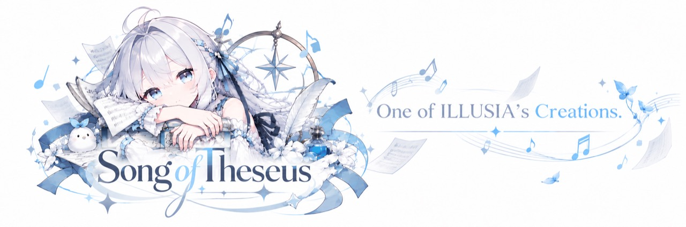

<a id="readme-top"></a>

<div align="center">
  <a href="https://github.com/Huddle-Up-Forge/song-of-theseus">
    
  </a>
  <h1>Song of Theseus</h1>
  <p><strong>让每一句，重新开口。</strong></p>
  <p>A local-first singing and lyric editing workstation.</p>
  <p>
    
    
    
  </p>
  <p>
    <a href="./README.md">English</a> · <a href="./README.zh-CN.md">简体中文</a> · <a href="./README.zh-TW.md">繁體中文</a>
  </p>
  <p>
    <a href="#overview">Overview</a> · <a href="#features">Features</a> · <a href="#community">Community</a> · <a href="#quick-start">Quick start</a> · <a href="#documentation">Documentation</a> · <a href="#credits">Credits & license</a>
  </p>
</div>

<a id="overview"></a>

## Overview

Song of Theseus is a local-first workspace for rewriting sung lyrics while keeping the melody. Upload a song, edit lines one by one, use a MIDI melody as a guide, preview replacements, and render a complete track on your own machine.

The singing backend is [YingMusic-Singer-Plus](https://github.com/ASLP-lab/YingMusic-Singer-Plus). This repository contains the web workbench and its integration; model code and checkpoints are downloaded separately. The project is for inference and does not include training tools.

<a id="features"></a>

## Features

| Workflow | What you can do |
| --- | --- |
| 🎙️ Lyric rewriting | Separate vocals and accompaniment, edit lyrics line by line, adjust each line's timing, and preview a re-sung line. |
| 🎼 MIDI lyric filling | Import MIDI, audition the melody, enter lyrics by phrase, and use the same singer reference across generated phrases. |
| ✍️ Lyric recognition | Create an editable timestamped draft with local Whisper large-v3, or provide your own LRC. Recognition can mishear singing, so review the text and timing. |
| 🎧 Full-song rendering | Keep unchanged vocals and the original accompaniment while replacing edited lines and joining the result. |
| 💾 Local workspaces | Keep projects, lyric drafts, singer profiles, and job history on your computer. |

<a id="community"></a>

## Community

Join the QQ group shared with [WebSpeak](https://github.com/EchoSixHIYA/WebSpeak-client-for-TeamSpeak) for discussion. **Group number: `869500475`.**

<p align="center">
  <a href="http://qm.qq.com/cgi-bin/qm/qr?_wv=1027&k=yhumUMDD9PmyYFWdXWUb_x7hM5trFQY8&authKey=Pw3HBGT7GwMinTQnuFGfnpf0aRSzXOJKcAiujVP1%2BXMpjheAKrncTRivicBJxpjV&noverify=0&group_code=869500475">
    
  </a>
  <br />QR code from the <a href="https://github.com/EchoSixHIYA/WebSpeak-client-for-TeamSpeak">WebSpeak repository</a>.
</p>

<a id="quick-start"></a>

## Quick start

### Docker deployment

For NVIDIA GPU systems, download the [one-click deployment bundle](https://github.com/Huddle-Up-Forge/song-of-theseus/releases/download/deploy-latest/song-of-theseus-deploy.zip), extract it, and run `deploy.bat` on Windows or `deploy.sh` on Linux. Docker Desktop with WSL 2 and NVIDIA GPU access is required on Windows. The first launch opens the model setup screen; downloaded weights and workspaces stay in the bundle's `data/` folder.

See [Docker deployment details](deploy/README.md). The source build is available in the repository's `Dockerfile`; published images are hosted at [GitHub Container Registry](https://ghcr.io/huddle-up-forge/song-of-theseus).

### Run from source on Windows

Set up the Python environments, CUDA-enabled PyTorch, and model checkpoints using [LOCAL_WINDOWS.md](LOCAL_WINDOWS.md) and the Plus upstream instructions:

1. Clone this repository and the official Plus checkout side by side:

   ```powershell
   git clone https://github.com/Huddle-Up-Forge/song-of-theseus.git
   git clone https://github.com/ASLP-lab/YingMusic-Singer-Plus.git ..\YingMusic-Singer-Plus
   ```

2. Run `run_local.bat` and open [http://127.0.0.1:23253](http://127.0.0.1:23253).

<a id="documentation"></a>

## Documentation

- [Windows setup and troubleshooting](LOCAL_WINDOWS.md)
- [Docker deployment bundle](deploy/README.md)
- [Third-party notices and license scope](THIRD_PARTY_NOTICES.md)
- [GNU AGPLv3-only license](LICENSE)

YingMusic-Singer-Plus, Whisper large-v3, and Demucs checkpoints are downloaded from their upstream sources in the model setup screen. Checkpoints and generated audio are not included in this repository or Docker image.

<a id="credits"></a>

## Credits & license

Thank you to the authors and maintainers of the models and tools used by this workbench:

- [YingMusic-Singer-Plus](https://github.com/ASLP-lab/YingMusic-Singer-Plus), by Chunbo Hao, Junjie Zheng, Guobin Ma, Yuepeng Jiang, Huakang Chen, Wenjie Tian, Gongyu Chen, Zihao Chen, and Lei Xie, for lyric-controlled singing synthesis and melody-preserving editing.
- [Demucs](https://github.com/facebookresearch/demucs) for vocal and accompaniment separation with `htdemucs`.
- [Faster-Whisper](https://github.com/SYSTRAN/faster-whisper) and [Whisper large-v3](https://huggingface.co/openai/whisper-large-v3) for local lyric transcription.
- YingMusic-Singer-Plus also acknowledges [F5-TTS](https://github.com/SWivid/F5-TTS), [Stable Audio](https://github.com/Stability-AI/stable-audio-tools), [SOME](https://github.com/openvpi/SOME), [DiffRhythm](https://github.com/ASLP-lab/DiffRhythm), [GTSinger](https://github.com/GTSinger/GTSinger), and [Emilia](https://github.com/open-mmlab/Emilia).

The original Song of Theseus application code in this repository is licensed under **GNU AGPLv3-only**. Separately downloaded model code and weights retain their upstream licenses; component sources and terms are listed in [THIRD_PARTY_NOTICES.md](THIRD_PARTY_NOTICES.md).

If you use the singing model in research, please cite the upstream work:

```bibtex
@article{hao2026yingmusicsingerplus,
  title={YingMusic-Singer: Controllable Singing Voice Synthesis with Flexible Lyric Manipulation and Annotation-free Melody Guidance},
  author={Hao, Chunbo and Zheng, Junjie and Ma, Guobin and Jiang, Yuepeng and Chen, Huakang and Tian, Wenjie and Chen, Gongyu and Chen, Zihao and Xie, Lei},
  journal={arXiv preprint arXiv:2603.24589},
  year={2026}
}
```

<p align="right"><a href="#readme-top">Back to top ↑</a></p>
