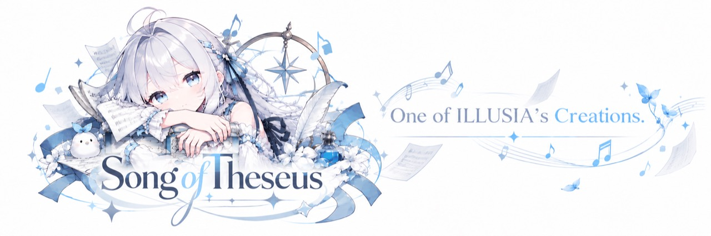

<a id="readme-top"></a>

<div align="center">
  <a href="https://github.com/Huddle-Up-Forge/song-of-theseus">
    
  </a>
  <h1>Song of Theseus</h1>
  <p><strong>讓每一句，重新開口。</strong></p>
  <p>以本機為優先的歌聲與歌詞編輯工作台。</p>
  <p>
    
    
    
  </p>
  <p>
    <a href="./README.md">English</a> · <a href="./README.zh-CN.md">简体中文</a> · <a href="./README.zh-TW.md">繁體中文</a>
  </p>
  <p>
    <a href="#overview">專案介紹</a> · <a href="#features">功能</a> · <a href="#community">交流群</a> · <a href="#quick-start">快速開始</a> · <a href="#documentation">文件</a> · <a href="#credits">致謝與授權</a>
  </p>
</div>

<a id="overview"></a>

## 專案介紹

Song of Theseus 是一套以本機為優先的歌聲與歌詞編輯工作台。上傳歌曲後，可以逐句修改歌詞、調整句子時間、用 MIDI 旋律輔助填詞、試聽替換片段，並在本機合成整首歌曲。

歌聲生成由 [YingMusic-Singer-Plus](https://github.com/ASLP-lab/YingMusic-Singer-Plus) 提供。本儲存庫包含網頁工作台及其串接程式碼；模型程式碼和權重需另行下載。本專案僅提供推理，不包含訓練工具。

<a id="features"></a>

## 功能

| 工作流程 | 功能說明 |
| --- | --- |
| 🎙️ 逐句改唱 | 分離人聲與伴奏，逐句修改歌詞、調整時間點，並預覽重唱片段。 |
| 🎼 MIDI 填詞 | 匯入 MIDI、試聽旋律、按樂句填寫歌詞，並讓生成片段共用同一份歌手參考音訊。 |
| ✍️ 歌詞辨識 | 使用本機 Whisper large-v3 產生帶時間戳的可編輯草稿，也可直接上傳 LRC。自動辨識可能誤聽演唱，請檢查歌詞和時間。 |
| 🎧 整曲生成 | 保留未修改的人聲與原伴奏，只替換修改過的歌詞片段並拼接輸出。 |
| 💾 本機工作區 | 在本機保存專案、歌詞草稿、歌手資料和工作歷史。 |

<a id="community"></a>

## 交流群

歡迎加入與 [WebSpeak](https://github.com/EchoSixHIYA/WebSpeak-client-for-TeamSpeak) 共用的 QQ 群交流。**群號：`869500475`。**

<p align="center">
  <a href="http://qm.qq.com/cgi-bin/qm/qr?_wv=1027&k=yhumUMDD9PmyYFWdXWUb_x7hM5trFQY8&authKey=Pw3HBGT7GwMinTQnuFGfnpf0aRSzXOJKcAiujVP1%2BXMpjheAKrncTRivicBJxpjV&noverify=0&group_code=869500475">
    
  </a>
  <br />二維碼來自 <a href="https://github.com/EchoSixHIYA/WebSpeak-client-for-TeamSpeak">WebSpeak 儲存庫</a>。
</p>

<a id="quick-start"></a>

## 快速開始

### Docker 部署

NVIDIA 顯示卡使用者可下載[一鍵部署套件](https://github.com/Huddle-Up-Forge/song-of-theseus/releases/download/deploy-latest/song-of-theseus-deploy.zip)，解壓縮後在 Windows 點擊 `deploy.bat`，或在 Linux 執行 `deploy.sh`。Windows 需要使用 WSL 2 並啟用 NVIDIA GPU 的 Docker Desktop。首次啟動會開啟模型設定頁；權重與工作區會保存在部署資料夾中的 `data/`。

詳見 [Docker 部署說明](deploy/README.md)。Docker 映像會由 GitHub Actions 建置並發布到 [GitHub Container Registry](https://ghcr.io/huddle-up-forge/song-of-theseus)。

### 從原始碼在 Windows 執行

依照 [LOCAL_WINDOWS.md](LOCAL_WINDOWS.md) 與 Plus 上游說明設定 Python 環境、CUDA 版 PyTorch 和模型權重：

1. 複製本儲存庫，並將官方 Plus 專案放在旁邊：

   ```powershell
   git clone https://github.com/Huddle-Up-Forge/song-of-theseus.git
   git clone https://github.com/ASLP-lab/YingMusic-Singer-Plus.git ..\YingMusic-Singer-Plus
   ```

2. 執行 `run_local.bat`，然後開啟 [http://127.0.0.1:23253](http://127.0.0.1:23253)。

<a id="documentation"></a>

## 文件

- [Windows 環境設定與疑難排解](LOCAL_WINDOWS.md)
- [Docker 部署套件](deploy/README.md)
- [第三方聲明與授權範圍](THIRD_PARTY_NOTICES.md)
- [GNU AGPLv3-only 授權條款](LICENSE)

YingMusic-Singer-Plus、Whisper large-v3 和 Demucs 權重會在模型設定頁從上游來源下載。本儲存庫和 Docker 映像均不包含模型權重或生成音訊。

<a id="credits"></a>

## 致謝與授權

感謝以下模型與工具的作者及維護者：

- [YingMusic-Singer-Plus](https://github.com/ASLP-lab/YingMusic-Singer-Plus)，作者 Chunbo Hao、Junjie Zheng、Guobin Ma、Yuepeng Jiang、Huakang Chen、Wenjie Tian、Gongyu Chen、Zihao Chen 和 Lei Xie，為本專案提供改詞演唱與旋律保持能力。
- [Demucs](https://github.com/facebookresearch/demucs)，用於 `htdemucs` 人聲與伴奏分離。
- [Faster-Whisper](https://github.com/SYSTRAN/faster-whisper) 和 [Whisper large-v3](https://huggingface.co/openai/whisper-large-v3)，用於本機歌詞辨識。
- YingMusic-Singer-Plus 上游另致謝 [F5-TTS](https://github.com/SWivid/F5-TTS)、[Stable Audio](https://github.com/Stability-AI/stable-audio-tools)、[SOME](https://github.com/openvpi/SOME)、[DiffRhythm](https://github.com/ASLP-lab/DiffRhythm)、[GTSinger](https://github.com/GTSinger/GTSinger) 和 [Emilia](https://github.com/open-mmlab/Emilia)。

本儲存庫中的 Song of Theseus 原創應用程式碼採用 **GNU AGPLv3-only**。模型程式碼與權重沿用各自上游授權；元件來源與授權列於 [THIRD_PARTY_NOTICES.md](THIRD_PARTY_NOTICES.md)。

如在研究中使用歌聲模型，請引用上游論文：

```bibtex
@article{hao2026yingmusicsingerplus,
  title={YingMusic-Singer: Controllable Singing Voice Synthesis with Flexible Lyric Manipulation and Annotation-free Melody Guidance},
  author={Hao, Chunbo and Zheng, Junjie and Ma, Guobin and Jiang, Yuepeng and Chen, Huakang and Tian, Wenjie and Chen, Gongyu and Chen, Zihao and Xie, Lei},
  journal={arXiv preprint arXiv:2603.24589},
  year={2026}
}
```

<p align="right"><a href="#readme-top">返回頂部 ↑</a></p>
